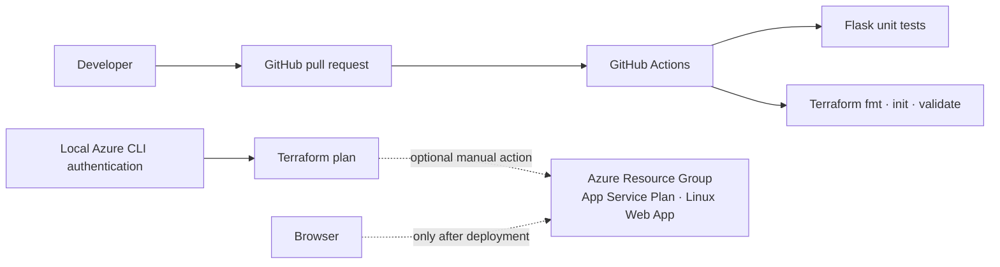

# Hospital Management Demo — Azure, Terraform & GitHub Actions

A learning project for an Azure DevOps portfolio. It combines a small Flask appointment demo, Terraform for Azure App Service infrastructure, and GitHub Actions CI for application tests and Terraform checks.

> **Learning demo only:** CarePoint is fictional. Do not enter real patient or medical information or use this application for clinical operations. Appointment data is in memory, resets on restart, and is not persisted or protected by authentication.

## Architecture



GitHub Actions runs tests and backend-free Terraform validation. It does **not** authenticate to Azure, apply Terraform, or deploy the application. No successful cloud deployment is claimed.

## Repository structure

```text
app/                       Flask demo, templates, requirements, unit tests
terraform/                 AzureRM provider and App Service infrastructure
.github/workflows/ci.yml   Application and Terraform CI
```

The demo stores appointments in process memory and has no database, authentication, authorization, CSRF protection, or clinical controls. It is not suitable for real patient data or production use.

## Run locally (Windows PowerShell)

```powershell
Set-Location app
py -m venv .venv
.\.venv\Scripts\Activate.ps1
python -m pip install -r requirements.txt
python app.py
```

Open `http://127.0.0.1:5000`. Run unit tests from the `app` directory:

```powershell
python -m unittest -v
```

The `/health` endpoint returns a simple health response for local learning and checks.

## Validate Terraform without Azure

From the repository root:

```powershell
Set-Location terraform
terraform fmt -check -recursive
terraform init -backend=false
terraform validate
```

These commands do not create Azure resources. The CI workflow performs the same Terraform checks without a backend.

## Optional manual Azure infrastructure

The Terraform configuration creates a resource group, Linux App Service Plan, and Linux Web App. This may incur charges. Review current Azure pricing, quotas, region availability, naming requirements, and the generated plan before applying.

1. Sign in and verify the target subscription:

   ```powershell
   az login
   az account show
   az account set --subscription "<your-subscription-id>"
   ```

2. From `terraform`, copy `terraform.tfvars.example` to the ignored `terraform.tfvars`. Enter only non-secret configuration values; use Azure CLI authentication rather than storing credentials.
3. Initialize, create, and inspect a saved plan:

   ```powershell
   terraform init
   terraform plan -out main.tfplan
   terraform show main.tfplan
   ```

4. Apply only after verifying the subscription, resources, names, and costs:

   ```powershell
   terraform apply main.tfplan
   ```

5. When finished, verify the resource group belongs exclusively to this learning project, then review and run:

   ```powershell
   terraform plan -destroy
   terraform destroy
   ```

Never delete resources based only on their names. Confirm they are managed by this project's Terraform state and are no longer needed.

## GitHub Actions and Azure authentication status

`.github/workflows/ci.yml` runs on pushes and pull requests targeting `main`, and on manual dispatch. It installs Python dependencies, runs the Flask unit tests, checks Terraform formatting, initializes without a backend, and validates the configuration.

There is currently **no Azure service authentication, OIDC federated credential, infrastructure apply, or application deployment workflow**. Before adding deployment automation:

- Configure a GitHub Actions OIDC identity in Microsoft Entra ID and a matching federated credential restricted to this repository and intended branch/environment.
- Grant only the target-scope Azure roles required by the workflow; do not use a subscription-wide Owner role for convenience.
- Configure a private remote Terraform backend with locking, least-privilege state access, and separate state keys for environments.
- Protect production with GitHub Environment reviewers and required checks.
- Keep deployment disabled until the identity, permissions, plan review, and rollback approach are tested.
- Never store Azure client secrets, subscription credentials, state, or plan files in Git.

## Troubleshooting

- **`ModuleNotFoundError: flask`:** activate the project virtual environment and install `app/requirements.txt`.
- **Terraform cannot select a subscription:** sign in with Azure CLI and verify `az account show`; set the intended subscription before initializing.
- **Terraform provider/init errors:** confirm outbound access to the Terraform Registry and AzureRM provider requirements.
- **Web App name already used:** the Azure name is globally unique; adjust the project naming input and review the plan.
- **No Actions run:** confirm the branch is `main`, workflow file is `.github/workflows/ci.yml`, and GitHub Actions is enabled for the repository.

## Next learning steps

- Add a separately reviewed Azure Blob remote-state configuration and environment-specific state.
- Add OIDC only after creating and testing the scoped federated identity and approvals.
- Add deployment only after defining an explicit application package/startup configuration and validation.
- Study persistence, authentication, authorization, and privacy before extending the fictional demo; do not use real medical data.
- Explore Azure Monitor/Application Insights and cost-aware diagnostic settings.
